# Sistem Pengelolaan Bantuan Sosial Daerah Samarinda

## Project Pemrograman Berorientasi Objek

**Nama:** Zefri Al Rizqullah  
**NIM:** 2509116084
**Program Studi:** Sistem Informasi Kelas C`2025  

---

## 1. Deskripsi Studi Kasus
**Sistem Pengelolaan Bantuan Sosial Daerah Samarinda** merupakan program berbasis Java yang digunakan untuk membantu proses pengelolaan data penerima bantuan sosial, data bantuan, serta pengajuan bantuan.

Program dibuat dalam bentuk aplikasi berbasis **Command Line Interface (CLI)** dan dijalankan menggunakan NetBeans.

Dalam program terdapat dua jenis penerima bantuan, yaitu:

1. Penerima Individu
2. Penerima Keluarga

Kedua jenis penerima memiliki data umum yang sama seperti ID penerima, NIK, nama, alamat, dan penghasilan. Namun, masing-masing jenis penerima juga memiliki data khusus.

**Penerima Individu** memiliki data tambahan berupa:

- Pekerjaan
- Status rumah

Sedangkan **Penerima Keluarga** memiliki data tambahan berupa:

- Jumlah anggota keluarga
- Jumlah tanggungan

Selain mengelola penerima, program juga dapat mengelola data bantuan dan pengajuan bantuan. Setiap pengajuan akan melalui proses pemeriksaan untuk menentukan apakah pengajuan **diterima** atau **ditolak** berdasarkan kriteria yang telah ditentukan.

---

## 2. Struktur Project
Project dibagi menjadi dua package utama, yaitu `app` dan `model`.

> **Gambar 1. Struktur Project**

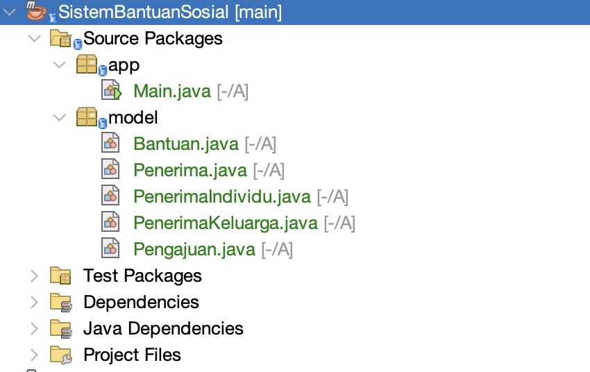

Package `app` berisi `Main.java` yang digunakan untuk menjalankan program dan mengatur seluruh menu.

Package `model` berisi class yang digunakan untuk membentuk object dan menyimpan data pada sistem.

---

## 3. Penjelasan Hierarki Class & Penerapan Inheritance
Hierarki class pada **Sistem Pengelolaan Bantuan Sosial Daerah Samarinda** menggambarkan hubungan antara class `Main`, `Penerima`, `PenerimaIndividu`, `PenerimaKeluarga`, `Bantuan`, dan `Pengajuan`.

```text
                         Main
                          │
                          │ Mengelola
                          ▼
        ┌─────────────────┼─────────────────┐
        │                 │                 │
        ▼                 ▼                 ▼
    Penerima           Bantuan          Pengajuan
        ▲                                   │
        │ Inheritance                       │ Menghubungkan
        │                                   │
   ┌────┴─────┐                      ┌──────┴──────┐
   │          │                      │             │
   ▼          ▼                      ▼             ▼
Individu   Keluarga               Penerima      Bantuan
```

Berdasarkan hierarki di atas, `Main` merupakan class utama yang mengatur jalannya program. Melalui class ini, program mengelola tiga data utama, yaitu **Penerima**, **Bantuan**, dan **Pengajuan**. Data tersebut disimpan menggunakan `ArrayList` dan kemudian dikelola melalui menu-menu yang tersedia pada program.

Pada bagian **Penerima** terdapat hubungan **inheritance atau pewarisan**. Class `Penerima` berperan sebagai **superclass (class induk)** yang menyimpan data umum seperti ID penerima, NIK, nama, alamat, dan penghasilan. Class tersebut kemudian diturunkan menjadi `PenerimaIndividu` dan `PenerimaKeluarga`. `PenerimaIndividu` memiliki data tambahan berupa pekerjaan dan status rumah, sedangkan `PenerimaKeluarga` memiliki data tambahan berupa jumlah anggota keluarga dan jumlah tanggungan. Dengan inheritance, kedua jenis penerima dapat menggunakan data dan method yang berasal dari class `Penerima` tanpa perlu menuliskannya kembali.

Sementara itu, class `Bantuan` digunakan untuk menyimpan informasi bantuan sosial, seperti ID bantuan, nama bantuan, nominal, dan jumlah kuota yang tersedia.

Class `Pengajuan` berfungsi sebagai **penghubung antara Penerima dan Bantuan**. Ketika penerima membuat pengajuan, object `Pengajuan` akan menyimpan penerima yang mengajukan, bantuan yang dipilih, ID pengajuan, serta status pengajuan. Status awal pengajuan adalah `Menunggu`, kemudian setelah diproses dapat berubah menjadi `Diterima` atau `Ditolak`.

Dengan demikian, alur hubungan antar class dapat dipahami secara sederhana sebagai Main mengelola seluruh data program, Penerima menjadi induk dari PenerimaIndividu dan PenerimaKeluarga, Bantuan menyimpan informasi bantuan yang tersedia, sedangkan Pengajuan menghubungkan Penerima dengan Bantuan yang diajukan. Struktur ini membuat pembagian fungsi setiap class menjadi lebih jelas sekaligus menerapkan konsep Pemrograman Berorientasi Objek, terutama **inheritance, encapsulation, object, dan hubungan antar class**.

Berikut merupakan penjelasan fungsi masing-masing class:

| Class | Fungsi |
|---|---|
| `Main` | Menjalankan program, menu, CRUD, dan proses pengajuan |
| `Penerima` | Menyimpan data umum penerima dan menjadi superclass |
| `PenerimaIndividu` | Menyimpan data khusus penerima individu |
| `PenerimaKeluarga` | Menyimpan data khusus penerima keluarga |
| `Bantuan` | Menyimpan informasi bantuan sosial |
| `Pengajuan` | Menghubungkan penerima dengan bantuan yang diajukan |

---

## 4. Penjelasan Lengkap Class

### 4.1 Class Penerima

`Penerima` merupakan superclass atau class induk yang menyimpan data umum penerima bantuan.

Atribut yang dimiliki yaitu:

```java
private String idPenerima;
private String nik;
private String nama;
private String alamat;
private double penghasilan;
```

ID penerima dibuat secara otomatis menggunakan:

```java
this.idPenerima = String.format("P%03d", i);
i++;
```

Sehingga ID yang dihasilkan berbentuk:

```text
P001
P002
P003
...
```

---

### 4.2 Class PenerimaIndividu

`PenerimaIndividu` merupakan subclass dari `Penerima`.

```java
public class PenerimaIndividu extends Penerima
```

Class ini memiliki atribut tambahan:

```java
private String pekerjaan;
private String statusRumah;
```

Dengan demikian, Penerima Individu tetap memiliki NIK, nama, alamat, dan penghasilan dari class `Penerima`, tetapi memiliki informasi tambahan berupa pekerjaan dan status rumah.

---

### 4.3 Class PenerimaKeluarga

`PenerimaKeluarga` juga merupakan subclass dari `Penerima`.

```java
public class PenerimaKeluarga extends Penerima
```

Class ini memiliki atribut tambahan:

```java
private int anggotaKeluarga;
private int jumlahTanggungan;
```

Data tersebut digunakan untuk menyimpan jumlah anggota keluarga dan jumlah tanggungan dari penerima.

---

### 4.4 Class Bantuan

Class `Bantuan` digunakan untuk menyimpan informasi bantuan sosial.

Atributnya terdiri dari:

```java
private String idBantuan;
private String namaBantuan;
private double nominal;
private int kuota;
```

ID bantuan dibuat secara otomatis dengan format:

```text
B001
B002
B003
...
```

Class ini juga memiliki method:

```java
public void kurangiKuota() {
    if (kuota > 0) {
        kuota--;
    }
}
```

Method tersebut digunakan untuk mengurangi kuota sebanyak satu ketika suatu pengajuan bantuan diterima.

---

### 4.5 Class Pengajuan

Class `Pengajuan` digunakan untuk menghubungkan object `Penerima` dengan object `Bantuan`.

Atribut utamanya yaitu:

```java
private String idPengajuan;
private String statusPengajuan;
private Bantuan bantuan;
private Penerima penerima;
```

Ketika pengajuan dibuat, ID dibuat otomatis dengan format:

```text
PG001
PG002
PG003
...
```

Sedangkan status awal pengajuan adalah:

```text
Menunggu
```

Setelah diproses, status dapat berubah menjadi:

```text
Diterima
```

atau:

```text
Ditolak
```

---

## 5. Alur Program
Program **Sistem Pengelolaan Bantuan Sosial Daerah Samarinda** dijalankan melalui terminal. Pengguna dapat mengelola data penerima, data bantuan, membuat pengajuan, hingga memproses pengajuan bantuan. Secara umum, alur program dimulai dari menu utama kemudian pengguna memilih proses yang ingin dilakukan.

### 5.1 Menjalankan Program dan Menu Utama
Saat program pertama kali dijalankan, sistem akan menampilkan menu utama. Menu ini menjadi pusat untuk mengakses seluruh fitur yang tersedia, yaitu mengelola data penerima, mengelola data bantuan, mengelola data pengajuan, dan memproses pengajuan bantuan.

> **Gambar 2. Tampilan Menu Utama**


---

### 5.2 Menambahkan Data Penerima
Sebelum membuat pengajuan bantuan, pengguna terlebih dahulu menambahkan data penerima. Sistem menyediakan dua jenis penerima, yaitu **Penerima Individu** dan **Penerima Keluarga**.

Pada penerima individu, pengguna mengisi data seperti NIK, nama, alamat, penghasilan, pekerjaan, dan status rumah. Setelah data berhasil ditambahkan, sistem akan memberikan ID penerima secara otomatis.

> **Gambar 3. Penambahan Data Penerima Individu**
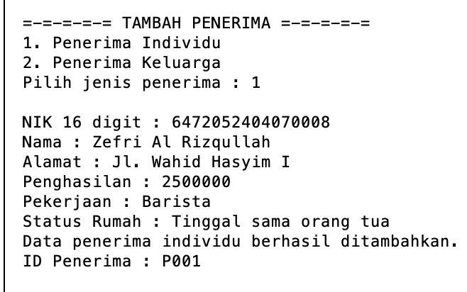

Untuk penerima keluarga, pengguna mengisi data umum penerima kemudian dilengkapi dengan jumlah anggota keluarga dan jumlah tanggungan. Sistem juga memberikan ID penerima secara otomatis.

> **Gambar 4. Penambahan Data Penerima Keluarga**
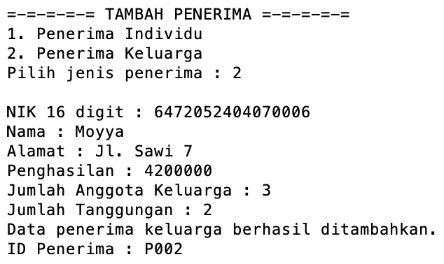

Setelah beberapa penerima ditambahkan, pengguna dapat menampilkan seluruh data penerima untuk melihat data yang telah tersimpan.

> **Gambar 5. Tampilan Data Penerima**
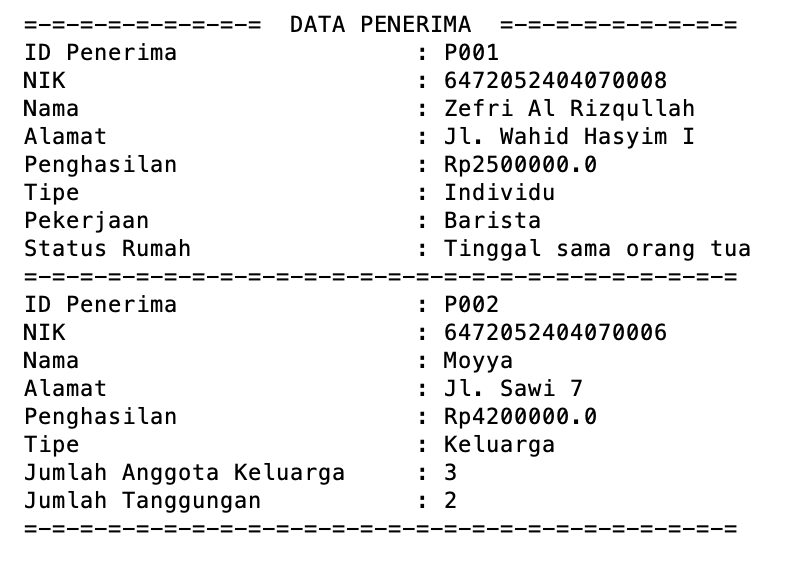

---

### 5.3 Mengubah Data Penerima
Data penerima yang sudah tersimpan dapat diperbarui apabila terdapat perubahan atau kesalahan data. Pengguna memilih ID penerima yang ingin diubah, kemudian memasukkan data terbaru. Sistem akan memperbarui data penerima tanpa mengubah ID penerima tersebut.

Fitur ini berfungsi sebagai proses **Update** pada pengelolaan data penerima.

> **Gambar 6. Proses Mengubah Data Penerima**
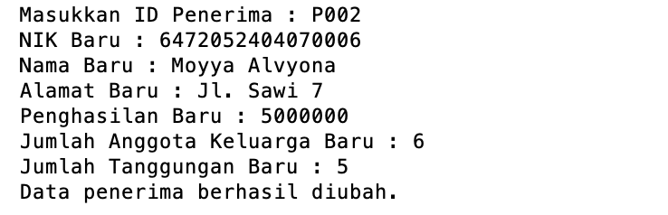

---

### 5.4 Menambahkan Data Bantuan
Setelah data penerima tersedia, pengguna dapat menambahkan jenis bantuan sosial yang akan diberikan. Data bantuan terdiri dari nama bantuan, nominal bantuan, dan jumlah kuota yang tersedia.

Setiap bantuan yang berhasil ditambahkan akan mendapatkan ID bantuan secara otomatis. Kuota yang dimasukkan nantinya digunakan untuk menentukan jumlah penerima yang dapat menerima bantuan tersebut.

> **Gambar 7. Penambahan Data Bantuan**
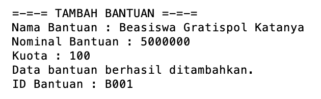

Pengguna juga dapat menampilkan daftar bantuan untuk mengetahui bantuan yang tersedia, nominal bantuan, serta sisa kuotanya.

> **Gambar 8. Tampilan Data Bantuan**
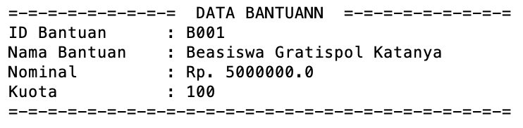

---

### 5.5 Membuat Pengajuan Bantuan

Setelah data penerima dan bantuan tersedia, penerima dapat membuat pengajuan bantuan. Pengguna memilih penerima berdasarkan ID penerima, kemudian memilih bantuan berdasarkan ID bantuan.

Jika data yang dipilih tersedia dan pengajuan berhasil dibuat, sistem akan memberikan ID pengajuan secara otomatis dengan status awal **Menunggu**. Status tersebut menunjukkan bahwa pengajuan sudah tercatat tetapi belum diproses.

> **Gambar 9. Proses Pembuatan Pengajuan Bantuan**
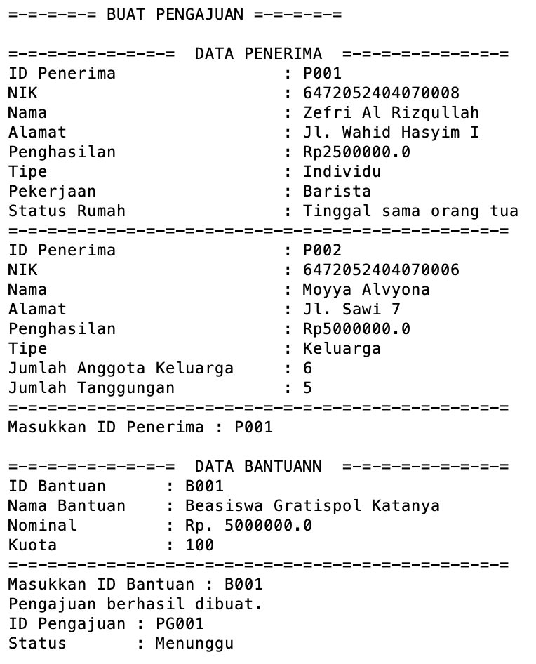

Pengguna kemudian dapat melihat seluruh pengajuan yang telah dibuat melalui menu tampilkan pengajuan.

> **Gambar 10. Tampilan Data Pengajuan**
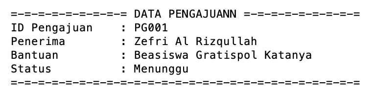

---

### 5.6 Memproses Pengajuan yang Diterima

Pengajuan yang masih berstatus **Menunggu** dapat diproses untuk menentukan apakah penerima memenuhi ketentuan bantuan.

Untuk **Penerima Individu**, pengajuan dapat diterima apabila penghasilannya tidak melebihi batas yang telah ditentukan. Sedangkan untuk **Penerima Keluarga**, sistem mempertimbangkan penghasilan dan jumlah tanggungan.

Apabila penerima memenuhi ketentuan dan kuota bantuan masih tersedia, status pengajuan akan berubah menjadi **Diterima**. Setelah pengajuan diterima, kuota bantuan secara otomatis berkurang satu.

> **Gambar 11. Pengajuan Bantuan Diterima**
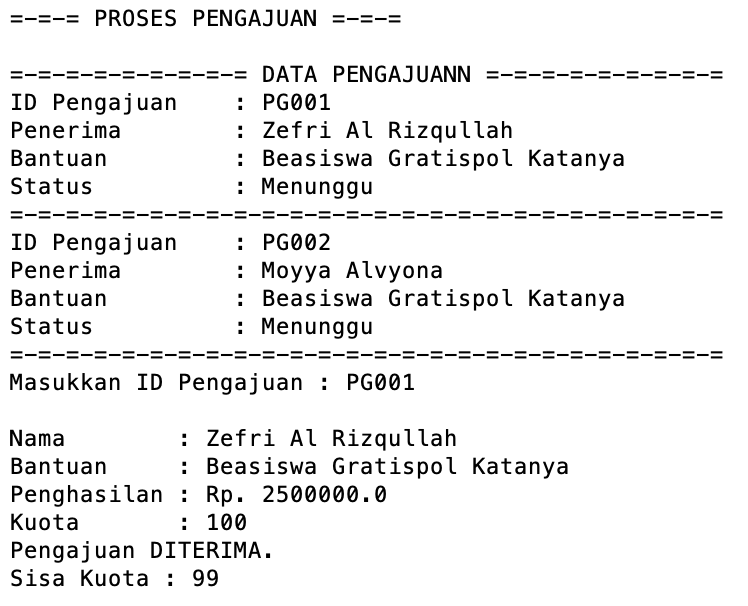

---

### 5.7 Memproses Pengajuan yang Ditolak

Pengajuan juga dapat ditolak apabila penerima tidak memenuhi ketentuan yang telah ditentukan.

Sebagai contoh, pengajuan penerima individu akan ditolak apabila penghasilannya melebihi batas. Pada penerima keluarga, pengajuan dapat ditolak apabila penghasilan melebihi batas atau tidak mempunyai tanggungan.

Ketika pengajuan ditolak, sistem akan mengubah status menjadi **Ditolak** dan menampilkan alasan penolakan.

> **Gambar 12. Pengajuan Bantuan Ditolak**
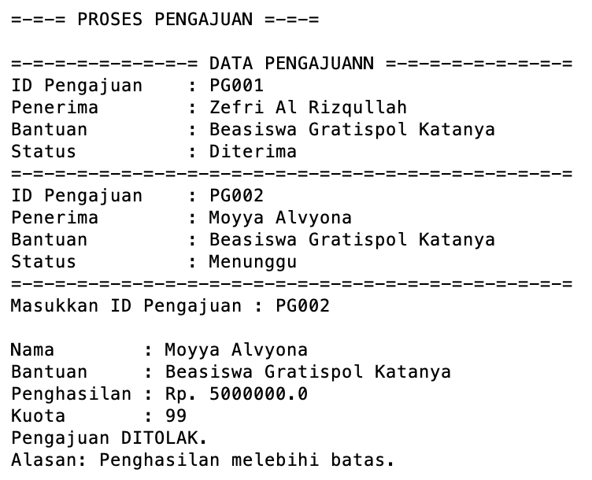

---

### 5.8 Validasi Kuota Bantuan

Program juga melakukan pemeriksaan terhadap kuota bantuan. Jika kuota suatu bantuan sudah habis, penerima tidak dapat membuat pengajuan baru untuk bantuan tersebut.

Validasi ini digunakan agar jumlah penerima bantuan tidak melebihi kuota yang tersedia.

> **Gambar 13. Validasi Kuota Bantuan Habis**
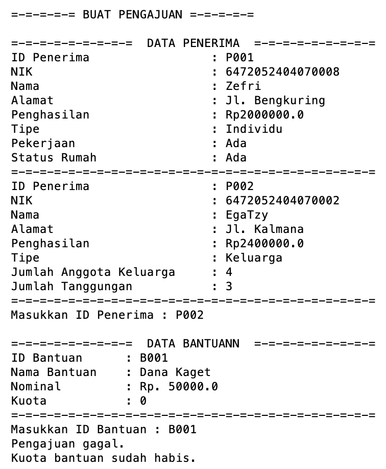

---

### 5.9 Validasi Pengajuan yang Sama

Sistem mencegah penerima membuat pengajuan yang sama apabila penerima tersebut masih mempunyai pengajuan bantuan yang sama dan pengajuannya belum ditolak.

Fitur ini digunakan untuk menghindari adanya pengajuan ganda dari penerima terhadap bantuan yang sama.


> **Gambar 13. Validasi Pengajuan Bantuan yang Sama**
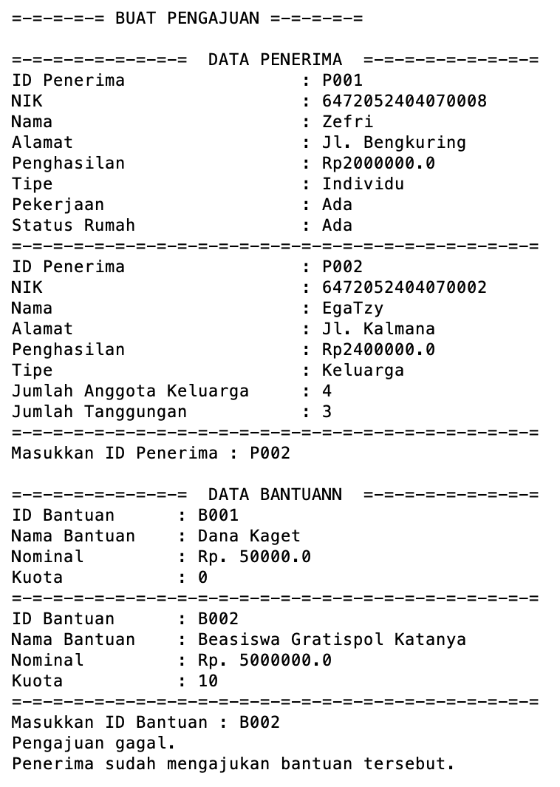

---

### 5.10 Menghapus Data Pengajuan

Pengajuan yang masih berstatus **Menunggu** dapat dihapus apabila terjadi kesalahan dalam pembuatan pengajuan. Pengguna cukup memilih ID pengajuan yang ingin dihapus.

Namun, pengajuan yang sudah diproses menjadi **Diterima** atau **Ditolak** tidak dapat dihapus karena pengajuan tersebut sudah memiliki hasil proses.

> **Gambar 14. Proses Menghapus Pengajuan**
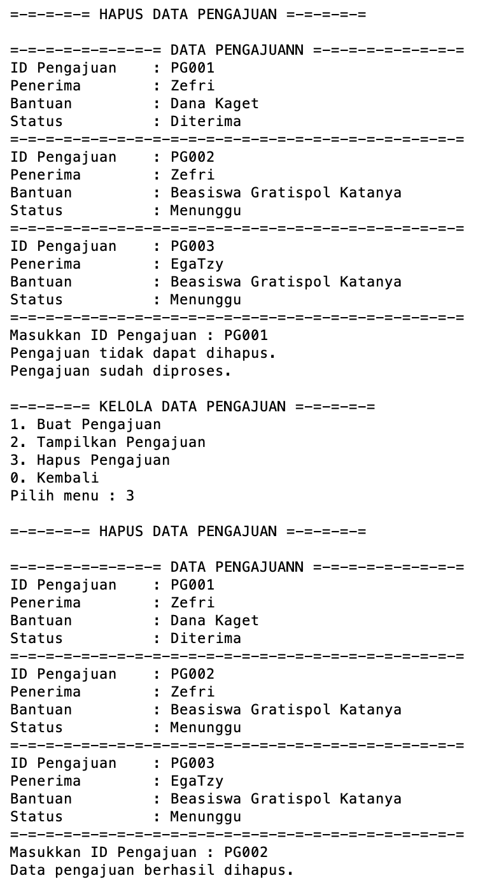

---

### 5.11 Menghapus Data Penerima dan Bantuan

Program menyediakan fitur untuk menghapus data penerima maupun bantuan. Data dapat dihapus selama belum digunakan dalam suatu pengajuan.

Apabila penerima sudah mempunyai pengajuan, data penerima tidak dapat dihapus. Begitu juga dengan bantuan yang sudah digunakan dalam pengajuan. Pembatasan ini digunakan untuk menjaga agar data pengajuan tetap memiliki hubungan dengan data penerima dan bantuan yang benar.

> **Gambar 15. Validasi Penghapusan Data Penerima**
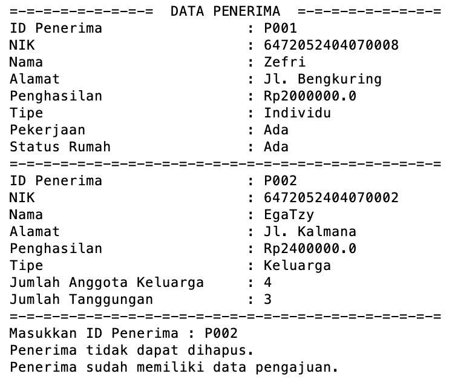

> **Gambar 16. Validasi Penghapusan Data Bantuan**
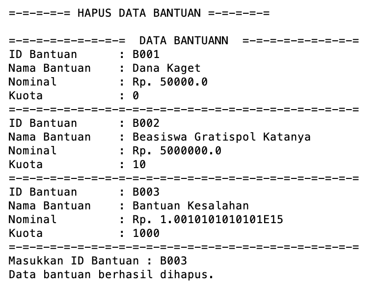

---

## 6. Gambaran Alur Keseluruhan Program

Secara keseluruhan, program dimulai dengan menyiapkan **data penerima** dan **data bantuan**. Setelah kedua data tersebut tersedia, pengguna dapat membuat **pengajuan bantuan** dengan memilih penerima dan bantuan yang diinginkan.

Pengajuan yang berhasil dibuat akan memiliki status awal **Menunggu**. Selanjutnya pengajuan diproses berdasarkan jenis penerima, penghasilan, jumlah tanggungan untuk penerima keluarga, serta ketersediaan kuota bantuan.

Apabila memenuhi ketentuan, pengajuan akan **Diterima** dan kuota bantuan berkurang. Apabila tidak memenuhi ketentuan, pengajuan akan **Ditolak** beserta alasan penolakannya.

Alur sederhananya dapat digambarkan sebagai berikut:

```text
Program Dimulai
      │
      ▼
Tambah Data Penerima
      │
      ▼
Tambah Data Bantuan
      │
      ▼
Buat Pengajuan
      │
      ▼
Status "Menunggu"
      │
      ▼
Proses Pengajuan
      │
      ├───────────────┐
      ▼               ▼
   Diterima         Ditolak
      │               │
      ▼               ▼
Kuota Berkurang   Alasan Ditampilkan
      │               │
      └───────┬───────┘
              ▼
       Data Pengajuan
        Dapat Dilihat
```

Dengan alur tersebut, program sudah menggambarkan proses sederhana pengelolaan bantuan sosial mulai dari **pendataan penerima, pendataan bantuan, pembuatan pengajuan, pemeriksaan pengajuan, sampai penentuan hasil pengajuan bantuan**.

---

# 7. Validasi yang Diterapkan

Beberapa validasi yang diterapkan dalam program yaitu:

1. Jenis penerima harus tersedia.
2. NIK harus memiliki panjang 16 karakter.
3. NIK tidak boleh digunakan oleh dua penerima.
4. Penghasilan tidak boleh negatif.
5. Jumlah anggota keluarga harus lebih dari 0.
6. Jumlah tanggungan tidak boleh negatif.
7. Jumlah tanggungan tidak boleh melebihi jumlah anggota keluarga.
8. Nominal bantuan harus lebih dari 0.
9. Kuota bantuan harus lebih dari 0 ketika bantuan dibuat.
10. ID penerima harus ditemukan sebelum pengajuan dibuat.
11. ID bantuan harus ditemukan sebelum pengajuan dibuat.
12. Pengajuan yang sama tidak dapat dibuat kembali selama pengajuan sebelumnya belum ditolak.
13. Pengajuan baru tidak dapat dibuat jika kuota bantuan habis.
14. Pengajuan yang sudah diproses tidak dapat diproses kembali.
15. Pengajuan yang sudah diproses tidak dapat dihapus.
16. Penerima yang sudah mempunyai pengajuan tidak dapat dihapus.
17. Bantuan yang sudah digunakan dalam pengajuan tidak dapat dihapus.

---

# 8. Skenario Pengujian Program

Agar pasti program berjalan sesuai rancangan, berikut beberapa skenario pengujian yang dapat dilakukan:

| No | Pengujian | Hasil yang Diharapkan |
|---|---|---|
| 1 | Tambah Penerima Individu | Data berhasil disimpan dan mendapat ID otomatis |
| 2 | Tambah Penerima Keluarga | Data berhasil disimpan dan mendapat ID otomatis |
| 3 | Memasukkan NIK yang sama | Program menolak NIK duplikat |
| 4 | Menampilkan penerima | Individu dan Keluarga tampil sesuai jenisnya |
| 5 | Mengubah penerima | Data penerima berhasil diperbarui |
| 6 | Menghapus penerima tanpa pengajuan | Data berhasil dihapus |
| 7 | Menghapus penerima yang memiliki pengajuan | Program menolak penghapusan |
| 8 | Menambahkan bantuan | Bantuan mendapat ID otomatis |
| 9 | Membuat pengajuan | Status awal menjadi Menunggu |
| 10 | Pengajuan memenuhi syarat | Status menjadi Diterima |
| 11 | Pengajuan tidak memenuhi syarat | Status menjadi Ditolak |
| 12 | Pengajuan diterima | Kuota bantuan berkurang satu |
| 13 | Membuat pengajuan ganda | Program menolak pengajuan |
| 14 | Mengajukan bantuan dengan kuota 0 | Program menolak pengajuan |
| 15 | Memproses pengajuan dua kali | Program menolak proses kedua |

---

# 9. Kesimpulan

**Sistem Pengelolaan Bantuan Sosial Daerah Samarinda** merupakan program berbasis Java yang digunakan untuk mengelola data penerima, bantuan, serta proses pengajuan bantuan sosial.

Program menerapkan konsep dasar Pemrograman Berorientasi Objek melalui penggunaan class dan object, constructor, encapsulation, inheritance, serta relasi antar object.

Inheritance diterapkan melalui class `Penerima` sebagai superclass, kemudian diturunkan menjadi `PenerimaIndividu` dan `PenerimaKeluarga`.

Program juga menggunakan `ArrayList` sebagai penyimpanan data sementara, percabangan untuk menentukan proses, perulangan untuk menjalankan menu dan membaca data, serta validasi untuk mencegah beberapa kesalahan input.

Pada proses pengajuan, program dapat menentukan apakah pengajuan diterima atau ditolak berdasarkan jenis penerima dan kriteria yang telah ditentukan. Jika pengajuan diterima, kuota bantuan akan berkurang secara otomatis.

Dengan adanya studi kasus ini, konsep dasar Pemrograman Berorientasi Objek dapat diterapkan dalam sebuah program sederhana yang memiliki hubungan antar class, pengelolaan data, validasi, dan aturan proses yang jelas.